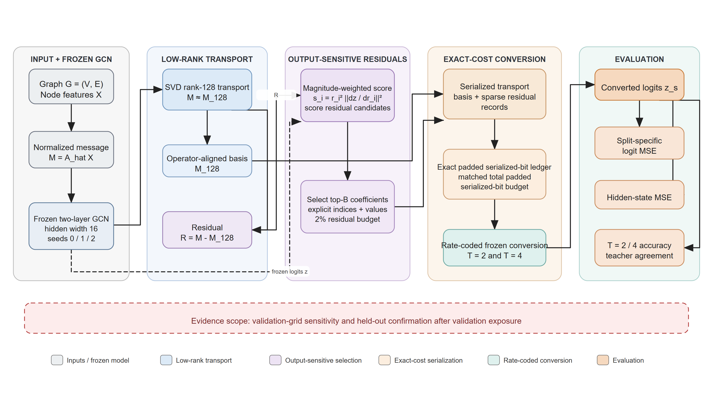

# Output-Jacobian Sparse Residual Allocation for Matched-Budget GNN-to-SNN Logit Fidelity

## Abstract

Frozen GNN-to-SNN compression must transport repeated high-dimensional AX messages under constrained serialization budgets. We ask whether output-Jacobian-selected sparse residual coefficients improve logit fidelity at a matched total padded serialized-bit budget while bounding task degradation. At rank 128 and a 2% sparse residual budget on the reported test split, selection reduced the ratio of three-seed mean split-specific logit MSE versus the strongest evaluated matched-budget control by 26.23%, 33.99%, and 25.83% on Cora, Chameleon, and Squirrel; all nine dataset-seed comparisons improved. Across T=2/4 accuracy and teacher agreement, the observed task loss was bounded at both 1.86 pp mean and 2.85 pp seed-level task loss. All compared rank-128/2% methods used identical total padded serialized bits within each dataset, although payload lengths and coefficient counts could differ. The timing range 1.020-1.124x comprised paired p95 full-pipeline runtime ratios versus SVD-only across nine dataset-seed pairs, and peak CUDA allocation was 218.23 MB. This is held-out confirmation after validation exposure, not preregistered or independent replication; sparse residual coefficients are not temporal SNN events, and no energy or broad GNN-generality claim is supported.

## 1 Introduction

Frozen GNN-to-SNN compression repeatedly transports high-dimensional AX messages, creating a specific problem of output-sensitive information loss under fixed serialization budgets. Low-rank transport can preserve large message components while omitting directions that matter for downstream logits. The unresolved question is whether an output-sensitive residual allocation can improve logit fidelity without exceeding the transport budget or incurring unbounded task degradation.

The evaluated approach retains an operator-aligned rank-128 SVD basis and allocates a 2% sparse residual budget to coefficients with high output-Jacobian sensitivity under an exact serialization ledger. All compared rank-128/2% methods used identical total padded serialized bits within each dataset, although payload lengths and coefficient counts could differ. The sparse residual coefficients are selected exact message residual values with explicit indices; they are not temporal spikes.

The evidence preview is deliberately bounded. At rank 128 and 2%, hidden-state MSE fell by 16.88%, 12.86%, and 10.63% relative to the strongest matched-budget control on Cora, Chameleon, and Squirrel. Across the evaluated 0.5%, 1%, and 2% residual budgets and three graphs, logit MSE was below the strongest corresponding control in all nine dataset-budget cells, with reductions from 2.98% to 30.40%; this validation-grid sensitivity analysis preceded held-out confirmation for the focal 2% setting. Relative to our matched-budget adaptations of A2Q and One-Spike, the evaluated selector reduced three-seed mean logit MSE by 28.93%, 36.19%, and 35.24%, and by 42.83%, 47.61%, and 34.03%, respectively, on Cora, Chameleon, and Squirrel. Task superiority was not established: T=2/4 accuracy and teacher-agreement deltas were mixed across budgets, and the earlier task-superiority target failed. The accepted claim is bounded task degradation rather than universal task gain.

## 2 Related Work

Graph-conversion work spans direct spiking GCNs \cite{spikinggcn}, dynamic spiking GNNs \cite{spikenet,dy-sign}, delayed dynamic models \cite{delay-dsgn}, temporal spiking GNNs \cite{signnn}, ANN-to-asynchronous-event-graph conversion \cite{asgcn}, converted-SNN acceleration \cite{fast-snn}, and output-code-oriented One-Spike SNNs \cite{one-spike}. These methods differ in source model, temporal semantics, and compute or transport assumptions, so their published outcomes are not direct measurements of a common matched-budget message-compression protocol.

Graph-message compression instead changes what is communicated. A2Q studies graph-aware learned quantization \cite{a2q}, AdaQP targets graph-message quantization and communication \cite{adaqp}, and the retained DCGS context concerns qualitative low-rank graph communication \cite{dcgs}. The trade-off is among coefficient count, payload length, reconstruction fidelity, and the accounting used to equalize cost. In this study, our matched-budget adaptations of A2Q and One-Spike are evaluated only under the exact serialized-cost ledger.

Output-sensitive coding asks which compressed values should be preserved for downstream outputs. One-Spike provides output-code context \cite{one-spike}, while A2Q provides graph-aware learned-quantization context \cite{a2q}; neither context alone establishes how output-Jacobian sensitivity should allocate sparse residual coefficients in frozen GNN-to-SNN compression. The present scope is frozen two-layer hidden-16 GCN checkpoints on Cora, Chameleon, and Squirrel, and the coefficients are exact residual values rather than temporal SNN events. Can output-Jacobian-selected sparse residual coefficients improve logit fidelity at a matched total padded serialized-bit budget while bounding task degradation in frozen GNN-to-SNN compression?

## 3 Method

We consider a frozen two-layer hidden-16 GCN checkpoint. For layer \(l\), the graph message is \(M^{(l)} = A H^{(l-1)}\), where \(A\) is the normalized adjacency operator and \(H^{(0)} = X\). The checkpoint computes

$$H^{(1)} = \sigma\left(\widetilde{D}^{-1/2}\widetilde{A}\widetilde{D}^{-1/2} X W^{(1)}\right), \qquad Z = \widetilde{D}^{-1/2}\widetilde{A}\widetilde{D}^{-1/2} H^{(1)} W^{(2)},$$

with hidden width 16 and frozen parameters. Results use checkpoint seeds 0, 1, and 2.

For each message matrix \(M = A X\), transport retains an operator-aligned rank-128 SVD representation,

$$M_{128} = U_{128}\Sigma_{128}V_{128}^{T}, \qquad R = M - M_{128}.$$

The residual is encoded as selected exact coefficients rather than as temporal spikes. For residual coefficient \(r_i\) at serialized position \(i\), let \(z = f_{\theta}(M_{128} + e_i r_i)\) be the frozen model output and define the output-Jacobian squared sensitivity

$$J_i = \frac{\partial z}{\partial r_i}, \qquad s_i = \lVert J_i \rVert_2^2.$$

Given a residual budget \(B\), the selector chooses the highest-scoring coefficient set \(S = \operatorname{TopB}(s_i)\) and transmits explicit pairs \((i,r_i)\). The exact serialized-cost ledger is

$$C(S) = \sum_{q \in \operatorname{records}(S)} \operatorname{padded\_serialized\_bits}(q),$$

where each record includes its payload and explicit indices. Comparisons therefore use a matched total padded serialized-bit budget within each dataset, seed, rank, and budget condition. All compared rank-128/2% methods used identical total padded serialized bits within each dataset, although payload lengths and coefficient counts could differ.

Rate-coded conversion represents each nonnegative post-activation value as a finite firing rate over \(T \in \{2,4\}\) bins; the decoded scalar is the spike count divided by \(T\). The frozen weights, graph message, and serialized-cost condition are held fixed across conversion comparisons. Sparse residual coefficients are exact message residual values with explicit indices and are not temporal SNN events. The measurement scope excludes hardware energy and does not establish temporal-event equivalence or broad GNN generality.

**Figure 1.** Exact-cost output-Jacobian residual transport for frozen GNN-to-SNN conversion. A rank-128 basis and selected sparse exact residual records are serialized under a matched total padded serialized-bit budget before rate-coded conversion.

## 4 Experiments and Results

### 4.1 Experimental Scope

We evaluate Cora, Chameleon, and Squirrel using the reported split protocol and frozen two-layer hidden-16 GCN checkpoints with seeds 0, 1, and 2. Validation was used for setting selection, and the focal setting and logit-fidelity reframing were fixed after validation exposure and before the test run. The reported test run is therefore held-out confirmation after validation exposure, not preregistered or independent replication.

We report split-specific logit MSE, hidden-state MSE, \(T=2/4\) accuracy, and teacher agreement. For logits \(z_s\) on split \(s\), the split-specific metric is

$$\operatorname{MSE}_{\operatorname{logit}}(s) = \frac{1}{|s|C}\sum_{n \in s}\lVert z_{n}^{\operatorname{converted}} - z_{n}^{\operatorname{frozen}}\rVert_2^2,$$

and hidden-state MSE is defined analogously on the hidden representation. Accuracy is measured at \(T=2\) and \(T=4\); teacher agreement is the fraction of converted predictions matching the frozen GCN prediction. Task comparisons are descriptive and do not establish equivalence.

### 4.2 Compared Methods and Exact Cost

The compared methods share the rank-128 transport and exact padded serialized-bit ledger. The strongest evaluated matched-budget control is the best-performing non-selector control for the corresponding comparison.

| Method | Representation and allocation | Role | Citation |
|---|---|---|---|
| SVD-only | Rank-128 basis; no residual coefficients | Matched-budget baseline | — |
| Output-Jacobian sparse residual | Rank-128 basis plus top-\(B\) exact residual pairs | Evaluated selector | — |
| Our matched-budget adaptations of A2Q | Graph-aware coefficient quantization under the same ledger | Adapted control | \cite{a2q} |
| Our matched-budget adaptations of One-Spike | Output-code coefficient allocation under the same ledger | Adapted control | \cite{one-spike} |

Within each dataset, seed, rank, and budget comparison, the ledger enforces identical total padded serialized bits for the proposed and control encodings, while their payload lengths and coefficient counts may differ. The strongest evaluated control is the non-proposed method with the lowest logit MSE under the corresponding exact-cost condition. The main fidelity comparison, sensitivity analysis, and task/runtime trade-offs are reported in Sections 4.3-4.5; all differences are descriptive, and no formal confidence interval is claimed.

### 4.3 Main Logit-Fidelity Result

At rank 128 and a 2% sparse residual budget on the reported test split, output-Jacobian selection reduced the ratio of three-seed mean split-specific logit MSE versus the strongest evaluated matched-budget control by 26.23% on Cora, 33.99% on Chameleon, and 25.83% on Squirrel; all nine dataset-seed comparisons improved. No formal confidence interval is claimed. This comparison used a matched total padded serialized-bit budget: all compared rank-128/2% methods used identical total padded serialized bits within each dataset, although payload lengths and coefficient counts could differ. The result is held-out confirmation after validation exposure because the focal setting and logit-fidelity reframing were fixed after validation exposure and before the test run.

**Figure 2.** Matched-budget logit fidelity on Cora, Chameleon, and Squirrel at rank 128 and a 2% residual budget. Bars show three-seed means and sample SD; lower is better.

### 4.4 Sensitivity and Matched-Budget Controls

At rank 128 and the 2% residual budget, hidden-state MSE fell by 16.88%, 12.86%, and 10.63% relative to the strongest matched-budget control on Cora, Chameleon, and Squirrel. These three-seed mean reductions are descriptive sensitivity results without formal confidence intervals and were obtained in the validation-grid analysis preceding held-out confirmation.

Across the evaluated 0.5%, 1%, and 2% residual budgets and three graphs, logit MSE was below the strongest corresponding control in all nine dataset-budget cells, with reductions from 2.98% to 30.40%. This validation-grid sensitivity result shows that the direction of the logit-MSE difference was consistent across the evaluated cells, while the focal 2% setting later received held-out confirmation after validation exposure.

**Figure 3.** Logit-MSE reduction over the evaluated residual-budget grid. The focal 2% setting later received held-out confirmation after validation exposure.

At rank 128 and 2%, the output-Jacobian selector reduced three-seed mean logit MSE relative to our matched-budget adaptations of A2Q \cite{a2q} and One-Spike \cite{one-spike}. Relative to our matched-budget adaptations of A2Q, the reductions were 28.93%, 36.19%, and 35.24% on Cora, Chameleon, and Squirrel; relative to our matched-budget adaptations of One-Spike, they were 42.83%, 47.61%, and 34.03%. These are descriptive paired comparisons under identical total padded serialized-bit budget conditions, with no formal confidence interval claimed.

### 4.5 Task and Runtime Trade-offs

Across T=2/4 accuracy and teacher agreement in the same rank-128/2% matched-budget comparison, the observed task loss was bounded at both 1.86 pp mean and 2.85 pp seed-level task loss. The first value is the maximum three-seed-mean degradation across T=2/4 accuracy and teacher agreement, and the second is the largest seed-level degradation. These values are bounded observations rather than an equivalence proof.

Task superiority was not established: T=2/4 accuracy and teacher-agreement deltas were mixed across the 0.5%-2% residual-budget grid, and the earlier task-superiority target failed. The accepted claim is bounded task degradation rather than universal task gain. The negative result is retained across dataset, budget, horizon, and seed rather than summarized as a general improvement.

For the rank128/1% full encode/selection/decode/conversion condition, the timing range 1.020-1.124x represents paired p95 full-pipeline runtime ratios versus SVD-only across nine dataset-seed pairs. The benchmark used an RTX3060 with three warmups and seven measured repeats, retained timing variance in the raw repeats, and recorded peak CUDA allocation of 218.23 MB. This is a wall-clock pipeline measurement and does not measure hardware energy.

**Figure 4.** Bounded task trade-off and warmed runtime overhead. Panel a reports official-test fidelity gains versus worst three-seed-mean task loss; panel b reports paired p95 runtime ratios at rank128/1%.

## 5 Discussion

Within the reported static-graph setting, the observed evidence supports a local fidelity-resource pattern: output-Jacobian-selected sparse residual coefficients reduced logit MSE under a matched total padded serialized-bit budget while the observed task loss remained bounded. The improvements over the strongest evaluated control, our matched-budget adaptations of A2Q and One-Spike, and the positive dataset-seed comparisons are descriptive observations. A plausible explanation is that squared output-Jacobian sensitivity preferentially retains residual directions that influence the frozen model outputs, but this is a mechanism hypothesis rather than an identified causal mechanism.

The evidence is limited to frozen two-layer hidden-16 GCN checkpoints on Cora, Chameleon, and Squirrel. The focal setting and logit-fidelity reframing were fixed after validation exposure and before the test run; the test run is held-out confirmation, not preregistered or independent replication. Sparse residual coefficients are not temporal SNN events, and no energy or broad GNN-generality claim is supported. These boundaries constrain the interpretation of both the logit-fidelity findings and the task trade-off.

## 6 Conclusion

Within the tested frozen-GCN scope, output-Jacobian-selected sparse residual coefficients improved logit fidelity at a matched total padded serialized-bit budget. At rank 128 and 2%, the ratio of three-seed mean split-specific logit MSE fell by 26.23%, 33.99%, and 25.83% on Cora, Chameleon, and Squirrel relative to the strongest evaluated matched-budget control, while the observed task loss was bounded at both 1.86 pp mean and 2.85 pp seed-level task loss. Task superiority was not established, and the result remains held-out confirmation after validation exposure within the evaluated static graphs.
