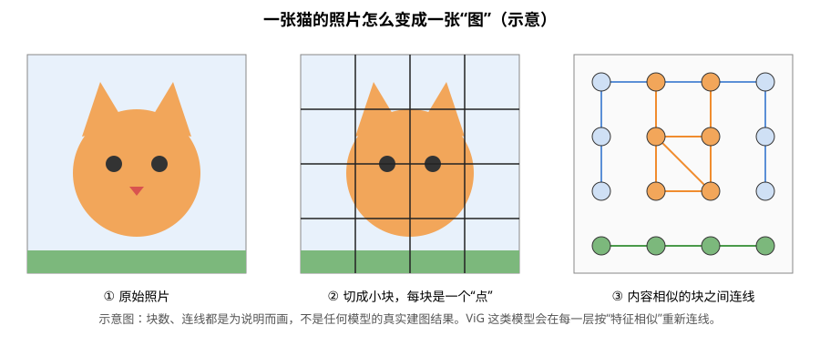
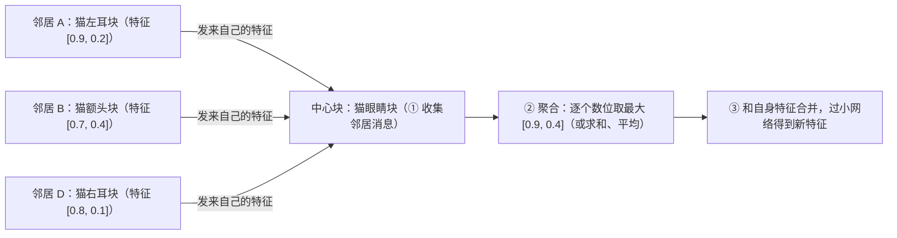
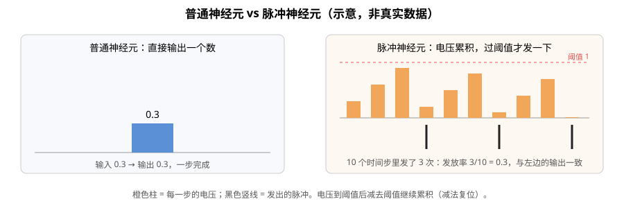
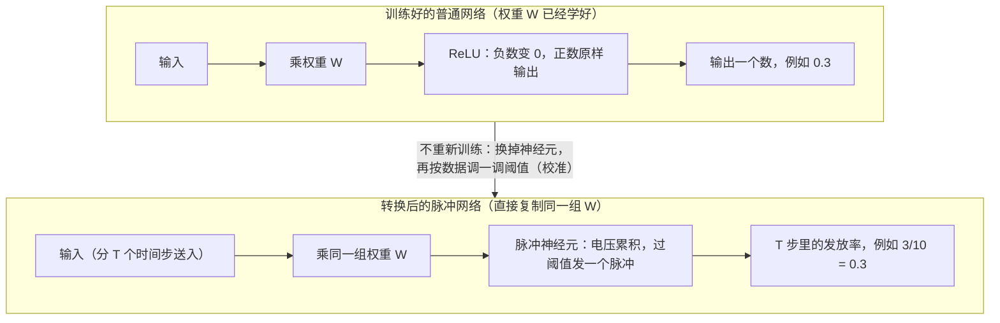

# 1 基础概念

> 本地化来源：[Notion 原页面](https://app.notion.com/p/41b0e3342e6f81d89aa3fad02e1a9faa)；由 `export_notion.py` 从只读块数据导出。

> 📌
> **一句话结论**：图神经网络让图片的每个小块向“邻居”打听消息；脉冲神经网络里每个计算单元攒够了才发一次信号；转换就是把前者的计算单元换成后者的，学到的参数照搬、不再训练。

全篇用同一个例子：**一张猫的照片**。下面每个概念都说明这张照片在这一步变成了什么。

### 1. 神经网络、神经元、训练

**打个比方**：神经网络像一条很多道工序的流水线，每道工序（一层）由许多工人（神经元）组成，每个工人把上游递来的几个数加权加起来，再决定往下游递一个什么数。

**准确地说**：一个神经元算的是“输入乘**权重**再相加”，然后过一个简单的函数，最常见的是 **ReLU**：负数变成 0、正数原样输出，作用相当于“信号不够强就不往下传”。网络由很多层串起来，每层加工一次。权重是**训练**出来的：给机器大量带答案的例子，让它反复微调权重直到答对。比方不成立的地方：流水线工人是一个接一个干活，而一层里成百上千个神经元是同时算的。

**猫的照片在这一步**：照片先变成一堆数（每个像素的颜色），一层层神经元把它们变成“这里有尖耳朵”“这里有胡须”这样的抽象特征，最后输出“是猫”。

### 2. 图、节点、边

**打个比方**：这里的“图”像一张人际关系网，每个人是一个点，关系近的人之间连一根线。

**准确地说**：这里的“图”（graph）不是图片，而是数学里的“点和线”：**节点**（点）带着一组数（**特征**），**边**（线）表示哪些节点算“邻居”。比方不成立的地方：人际关系基本固定，而有些视觉图网络在每一层都会重新决定谁和谁相连。

**猫的照片在这一步**：把照片切成小块，每块是一个节点；内容相似的块之间连边。注意“近”指内容像，不是位置挨着：两只耳朵的块即使相隔很远，也可能互为邻居。

*这张图想让你看到的是：照片切成小块，每块是一个点，内容相似的块之间连线，就得到一张“图”。示意，非真实建图结果。*

### 3. 图神经网络：向邻居打听消息

**打个比方**：每个点向自己的邻居打听情况，把听到的汇总一下，更新自己的看法。

**准确地说**：图神经网络（GNN）的每一层做三件事：收集邻居的特征（**消息传递**）；把它们合成一个（**聚合**），常见的有求和、平均、**取最大值**；再和自己原来的特征合起来更新。“取最大值”是对每一个位置分别取：邻居特征 [0.9, 0.2] 和 [0.7, 0.4] 取最大得 [0.9, 0.4]。比方不成立的地方：人打听消息可以挑着听，GNN 的聚合规则是固定的公式。

*图注：这张图想让你看到的是一个点怎么从邻居那里收集信息、合成一个，再更新自己。图中的数字是示意，非真实数据。*

### 4. 视觉图网络：三种常见的“图”

本项目最关心前两种“每层重新找邻居”的模型，第三种是固定图，用来对照。

- **图片**：ViG 把图片切成块当节点，每一层都按块的特征重新找最像的 k 个邻居（**kNN**，k 近邻），再取最大值聚合 [ViG 与 Pyramid ViG（2022）](https://app.notion.com/p/41b0e3342e6f8167be5fc852220398d0)。它取最大值的对象是“邻居减自己”的差值，可以理解为“邻居比我多出了什么”。
- **点云**：激光雷达（例如自动驾驶车顶的扫描仪）扫出的一堆三维点。DGCNN 每层按特征重新找最近的 k 个点，再取最大值聚合 [DGCNN（2019）](https://app.notion.com/p/41b0e3342e6f811682d7dcfddfefb7e0)。
- **人体骨架**：关节是节点，骨头是边，图是固定的。ST-GCN 在这张固定图上做加权求和 [ST-GCN（2018）](https://app.notion.com/p/41b0e3342e6f8147b449ee3bd25011a5)。
> ✅
> **事实**：ViG 确实每一层都按当前特征重新找邻居，这一点已对照官方代码逐行核对（细节见 [questions.md Q6](https://github.com/Casey-sketch-cyber/gnn2gsnn/blob/main/literature/questions.md)）[ViG 与 Pyramid ViG（2022）](https://app.notion.com/p/41b0e3342e6f8167be5fc852220398d0)。

### 5. 脉冲神经网络

**打个比方**：普通神经元像一直开着的水龙头，开多大就流多少；脉冲神经元像一只水桶，水一点点攒，攒满一桶就“哗”地倒出一桶的量，溢出的部分留在桶里接着攒。

**准确地说**：脉冲神经元有一个内部电压（**膜电位**）。每个**时间步**把输入加到电压上，电压超过**阈值**就发出一个**脉冲**（只有“有 / 没有”），然后电压减去阈值，多出来的部分保留（**减法复位**）。一个数靠“若干步里发了几次”来表示：例如 10 步里发了 3 次，就代表 0.3，这个比例叫**发放率**，步数常记作 **T**。比方不成立的地方：水桶倒水是物理过程，脉冲网络在芯片上是数字计算。

**猫的照片在这一步**：“耳朵块”某个特征原本是 0.3，转换后变成“10 步里发 3 次脉冲”。

[打开本地附件：f3-neuron-vs-spiking.html](../assets/41b0e334-f3-neuron-vs-spiking.html)

*交互动画（可暂停）*

*上面是可以暂停、拖动的交互版；下面是同一内容的静态图，导出成文件后也能看。*

*这张图想让你看到的是：普通神经元直接输出一个数；脉冲神经元电压一点点累积，攒够阈值才发一下，用“发了几次”表示同一个数。示意，非真实数据。*

**为什么可能省电**：普通网络每一步都要做“乘法再加法”；脉冲只有 0 和 1，乘以 1 等于原数、乘以 0 等于不用算，所以只剩加法，没脉冲的地方什么都不算。

> 💭
> **判断（需谨慎）**：“脉冲网络一定更省电”不是定论。另一种常见的省电做法是**量化**——把网络里的数从 32 位精度变成 8 位或 4 位的粗糙整数。多篇硬件研究发现，在单张静态图片上，脉冲网络往往比不过同样位数的量化网络；脉冲网络更有希望的场景是视频这类前后变化很小的输入（详见第 5、6 页）[Ottati 等：To Spike or Not To Spike（2023）](https://app.notion.com/p/41b0e3342e6f8159b316d791d77137e8)。

了解即可：有些新方法允许一个脉冲带一个数值（**分级脉冲**），不再只有“有 / 没有”，这样用更少的步数就能表示一个数（第 2 页的 DCGS 就是这样）。

### 6. 转换

**打个比方**：同一位翻译家，经验（权重）不变，只是传话方式从说中文变成发摩斯电码。

**准确地说**：ANN→SNN 转换（ANN 指普通神经网络，SNN 指脉冲神经网络）是把训练好的网络里的 ReLU 换成脉冲神经元，权重直接复制，再用少量数据调一下阈值这类“旋钮”（**校准**）。**免训练**指不再改动权重，花费很小。比方不成立的地方：摩斯电码是精确的，而脉冲表示有误差，时间步越少误差越大。

*图注：这张图想让你看到的是“同一个网络，换了神经元，结果基本不变”：左边输出 0.3，右边 10 步里发 3 次脉冲，发放率也是 0.3（示意，非真实数据）。*

> ✅
> **事实**：很多转换方法其实要先改造并重新训练原网络，例如 QCFS 要把原网络的一部分换掉——其中就包括把“取最大值”的操作换成“取平均”——再重训 300 轮 [QCFS（2022）](https://app.notion.com/p/41b0e3342e6f810591f7f303160e35ff)。最好的免训练方法之一 DCGS，在标准图像识别测试（ImageNet）上只用 4 个时间步，准确率 81.11%，比原模型（81.38%）只低 0.27 个百分点 [DCGS（2025）](https://app.notion.com/p/41b0e3342e6f81d8b1d1ccbe05acdde2)。

“取最大值”在转换里经常被换掉，这正是视觉图网络转换的难点之一（第 2、7 页）。

**三句话小结**

1. 图神经网络让每个点向邻居收集消息再更新，视觉图网络还会每层按内容重新找邻居。
1. 脉冲神经元攒够了才发一次，用“发了几次”表示一个数，步数越多越准。
1. 转换是换掉神经元、权重照搬；很多方法其实还要先改造并重训原网络。
**读完应该能回答的两个问题**

- 为什么脉冲网络里“一个数”要用好几个时间步来表示？
- ViG 和 ST-GCN 的“图”有什么不同？
