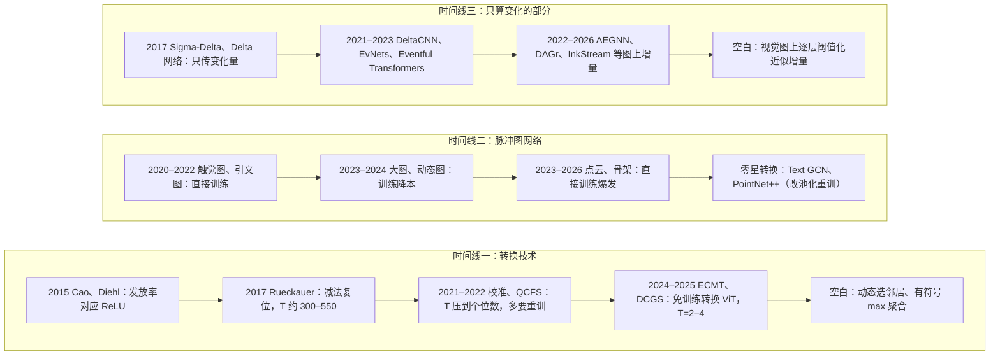
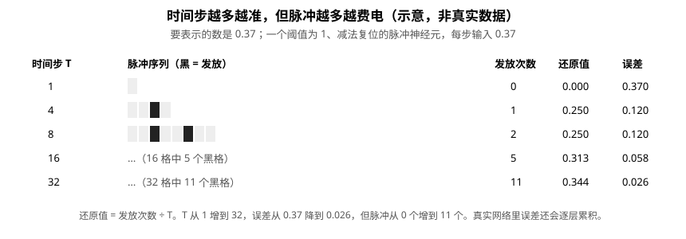

# 2 时间线：转换技术

> 本地化来源：[Notion 原页面](https://app.notion.com/p/41b0e3342e6f81d9ad63c20ebe0b51b5)；由 `export_notion.py` 从只读块数据导出。

> 📌
> **一句话结论**：十年里，转换技术把所需的时间步从几百降到个位数，把适用范围从小型卷积网络（用小窗口在整张图片上滑动扫描的传统看图模型）扩到 Transformer（让所有图块互相打分交换信息的大模型）；但“最大值”这类操作一直是难点，视觉图网络还没进入这条线。

先看全景：三条时间线各自的里程碑（第 2、3、5 页分别展开）。

*图注：这张图想让你看到的是三条线各自走到了哪一步，以及每条线末尾还空着什么。方框里的年份和结论都来自文献库条目。*

### 一步步解决了什么

**打个比方**：像学一门外语，最早要说很久对方才听懂（时间步很多），后来越说越简洁；但一开始只会说简单句（简单网络），后来才会说复杂句（Transformer）。

**准确地说**：每一代方法都在三件事之间取舍——时间步多少、要不要重训原网络、能处理哪些运算。比方不成立的地方：学外语是越学越好，而转换方法常常是“步数少了，就得重训原网络”，不是单纯进步。

| 年份 | 代表工作 | 解决了什么 | 留下了什么 |
| --- | --- | --- | --- |
| 2015 | Cao 等 [Spiking Deep CNN 奠基（2015）](https://app.notion.com/p/41b0e3342e6f817bb31fc077803fd854)、Diehl 等 [Weight & Threshold Balancing（2015）](https://app.notion.com/p/41b0e3342e6f814d9c5cd7dbcc3e1841) | 发现发放率可以对应 ReLU 的输出，并按层归一化权重 | 原网络不能有偏置（神经元额外加上的底数）、不能用最大池化（在小区域里只留最大值）；需要几百个时间步 |
| 2017 | Rueckauer 等 [SNN Toolbox（2017）](https://app.notion.com/p/41b0e3342e6f81a3b2f0dca38f8f241d) | 减法复位、支持批归一化（把每层输出拉回稳定范围）和最大池化，能直接转换标准网络 | 需要 300–550 个时间步 |
| 2019–2020 | Spike-Norm [Spike-Norm（2019）](https://app.notion.com/p/41b0e3342e6f815d96d5cd4423a54b93)、RMP-SNN [RMP-SNN（2020）](https://app.notion.com/p/41b0e3342e6f815c9d73d7b48bccc386)、Spiking-YOLO [Spiking-YOLO（2020）](https://app.notion.com/p/41b0e3342e6f81498d48f9ad639042f8) | 推到 ImageNet 深层网络和目标检测（在图里框出物体） | ImageNet 上要 2500 步（Spike-Norm）或 512–4096 步（RMP-SNN） |
| 2021–2023 | 校准 [SNNC-AP / SNN Calibration（2021）](https://app.notion.com/p/41b0e3342e6f81449ff6c194ab8d964a)、QCFS [QCFS（2022）](https://app.notion.com/p/41b0e3342e6f810591f7f303160e35ff)、偏移校准 [COS（2023）](https://app.notion.com/p/41b0e3342e6f81aa9cccf5ca27331479) | 分析误差来源，把时间步压到个位数 | 多数要先改造并重训原网络，最大池化要换成平均池化（留平均值） |
| 2024 | STA [STA（2024）](https://app.notion.com/p/41b0e3342e6f814f9595dcc2bb722d1c)、SpikeZIP-TF [SpikeZIP-TF（2024）](https://app.notion.com/p/41b0e3342e6f81e2a77bf2c3063d849f)、ECMT [ECMT（2024）](https://app.notion.com/p/41b0e3342e6f81fb8512ef5304537699) | 转换 Transformer：注意力（按相关度给别的块打分）、归一化、GELU（平滑版 ReLU） | STA 免训练但要 64–256 步；SpikeZIP-TF 要先重训；ECMT 的非线性部分仍用浮点计算（普通电脑带小数点的精确数运算） |
| 2025 | DCGS [DCGS（2025）](https://app.notion.com/p/41b0e3342e6f81d8b1d1ccbe05acdde2)、Bu 等 [Inference-Scale Conversion（2025）](https://app.notion.com/p/41b0e3342e6f8189b3dcdf43ac9f4e6e) | 免训练、2–4 步转换视觉版 Transformer（ViT）；最大池化挪到脉冲神经元之前算 | DCGS 代码遇到重叠的最大池化就退回浮点；都没有涉及图 |
| 2026 | MBE 神经元 [MBE 脉冲浮点转换（2026）](https://app.notion.com/p/41b0e3342e6f81e5b9eaf84dbb01a5cf) | 免训练、全脉冲地逼近各种非线性 | 16 步时 85.31%，10 步时跌到 21.99% |

> ✅
> **事实**：DCGS 在 ImageNet 上，ViT-Small 用 4 个时间步达到 81.11%（原网络 81.38%）；在 COCO 目标检测数据集上用 4 步达到 44.1% mAP（检测综合准确率，原网络 45.7%）[DCGS（2025）](https://app.notion.com/p/41b0e3342e6f81d8b1d1ccbe05acdde2)。它的多阈值神经元有正负对称的 2n 级阈值，代码默认 n = 8，即 16 级（见 [questions.md Q5](https://github.com/Casey-sketch-cyber/gnn2gsnn/blob/main/literature/questions.md)）。

### 时间步多少的影响

**打个比方**：用“举手次数”报一个分数——给你 4 次机会只能报到四分之一精度，给你 32 次就细得多，但举手也累得多。

**准确地说**：一个数在脉冲网络里靠“T 步里发几次”表示，T 越大越准，但发的脉冲越多，计算和能耗也越多。比方不成立的地方：真实网络里误差会一层层累积，而且新方法（如分级脉冲）一次能带一个数值，不完全靠次数。

[打开本地附件：f5-timesteps.html](../assets/41b0e334-f5-timesteps.html)

*交互动画（可暂停）*

*上面是可以暂停、拖动的交互版；下面是同一内容的静态图，导出成文件后也能看。*

*这张图想让你看到的是：时间步越多，还原出的数越准，但发的脉冲也越多、越费电。示意，非真实数据。*

### 最大值（max）这类操作为什么一直难

最大池化在普通卷积网络里很常见，视觉图网络的“取邻居最大值”也是同一类操作。

- 早期办法是绕开：把最大池化换成平均池化再重训原网络，QCFS、校准方法都这样做 [QCFS（2022）](https://app.notion.com/p/41b0e3342e6f810591f7f303160e35ff) [SNNC-AP / SNN Calibration（2021）](https://app.notion.com/p/41b0e3342e6f81449ff6c194ab8d964a)。
- 纯脉冲电路的办法：逐步取最大会系统性高估，侧抑制池化（先发脉冲的神经元抑制周围，减少重复计数）可以纠正，但要求输入非负、需要 16–32 步 [Burst + LIPooling（2022）](https://app.notion.com/p/41b0e3342e6f81ee8cf8c39f24740761)；Loihi 类脑芯片上的电路需要 50–120 步 [Spiking MaxPooling 电路（2022）](https://app.notion.com/p/41b0e3342e6f81659b92e95317f25094)。
- Bu 等的办法：利用“先取最大再 ReLU 等于先 ReLU 再取最大”（最大值大于 0 时成立），把最大池化挪到脉冲神经元之前、对累积的连续值直接比较 [Inference-Scale Conversion（2025）](https://app.notion.com/p/41b0e3342e6f8189b3dcdf43ac9f4e6e)。
> 💭
> **判断（来自文献核查）**：这几种办法都不能原样用在 ViG 上，因为 ViG 取最大值的对象是“邻居减自己”的差值，可正可负，后面也没有 ReLU（见 [audit 文件](https://github.com/Casey-sketch-cyber/gnn2gsnn/blob/main/literature/audit-of-claude-v1.md)难点树第 5 行）。

> ❓
> **未知**：在视觉图网络上，用 2–4 个时间步时最大值聚合会产生多大误差，没有实验数据。

**三句话小结**

1. 时间步从几百降到个位数，靠的是误差分析、校准和多阈值神经元。
1. 很多低步数方法要先重训原网络；真正免训练又能到 2–4 步的代表是 DCGS。
1. 最大值操作一直被绕开或特殊处理，现有办法都不能直接搬到 ViG 上。
**读完应该能回答的两个问题**

- 为什么 QCFS 这类方法虽然步数少，但不符合本项目“免训练”的路线？
- Bu 等处理最大池化的办法，为什么不能直接用在 ViG 上？
